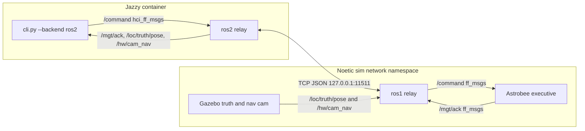

# M2 — ROS 2 client for the Noetic sim

A ROS 2 Jazzy process can undock, fly to rack alpha, and dock the existing
Noetic Astrobee sim. NASA flight code is not modified. The same Python intent
parser, sequencer, and safety rules run on the Jazzy side (`cli.py --backend ros2`).

## Why this is not ros1_bridge

`ros1_bridge` has to be compiled against ROS 1 and ROS 2 in one process.
Upstream says that does not work on Ubuntu 24.04: Noetic has no Noble packages,
so Jazzy and Noetic cannot be installed together. Humble on Ubuntu 20.04 is the
last combination they mark as supported, and that still means building all of
Humble from source inside the Astrobee image.

Even that build would not carry `ff_msgs`. A stock bridge only knows the
messages it was compiled with. Command and ack would need a generated mapping
package either way.

So the Jazzy container stays a normal `ros:jazzy-ros-base` image, and a small
relay on each side forwards five topics. The mapping is the dict codec in
`hci/crew_assist/bridge_codec.py`, checked by pytest with no ROS installed.
Humble was not required.

## Architecture



`hci/up.sh` starts four pieces on one network namespace (the sim container's):

| Service | Image | Role |
|---|---|---|
| `sim` | NASA Noetic image plus HCI desktop packages | Gazebo ISS, executive, Xvfb, browser UI |
| `crew` | same | ROS 1 crew node for the browser and `./hci/smoke.sh` |
| `ros1_relay` | same | TCP server, ROS 1 publishers and subscribers |
| `ros2` | `ros:jazzy-ros-base` plus `hci_ff_msgs` | TCP client, ROS 2 publishers and subscribers |

They share the network namespace because a ROS 1 node has to reach
`127.0.0.1:11311`, and because Docker bridge routing between containers is not
reliable everywhere (it was not on the machine that ran the M1 sortie). The
Jazzy relay sets `ROS_AUTOMATIC_DISCOVERY_RANGE=LOCALHOST`. It never talks DDS to the simulator.
The simulator is still launched with `dds:=false`.

## What is bridged

| Topic | ROS 1 type | ROS 2 type | Direction |
|---|---|---|---|
| `/command` | `ff_msgs/CommandStamped` | `hci_ff_msgs/msg/CommandStamped` | ROS 2 → ROS 1 |
| `/mgt/ack` | `ff_msgs/AckStamped` | `hci_ff_msgs/msg/AckStamped` | ROS 1 → ROS 2 |
| `/loc/truth/pose` | `geometry_msgs/PoseStamped` | `geometry_msgs/msg/PoseStamped` | ROS 1 → ROS 2 |
| `/loc/pose` | `geometry_msgs/PoseStamped` | `geometry_msgs/msg/PoseStamped` | ROS 1 → ROS 2 |
| `/hw/cam_nav` | `sensor_msgs/Image` | `sensor_msgs/msg/Image` | ROS 1 → ROS 2 |
| `/hci_bridge/ready` | (not on ROS 1) | `std_msgs/msg/Bool`, latched | relay → clients |

`hci_ff_msgs` is an HCI package. The fields match NASA's `ff_msgs` command and
ack messages. It is not a copy of the flight package, and nothing in the NASA
tree was edited to produce it. Two constant names are spelled `DATA_TYPE_VEC3D`
and `DATA_TYPE_MAT33F` because ROS 2 rejects `VEC3d` and `MAT33f` as constant
names. The numeric values are still 6 and 7, which is what the executive reads.

`/gnc/ekf` (`ff_msgs/EkfState`) is not bridged. The truth pose is already a
`PoseStamped` from the Gazebo truth plugin, which is what a client needs to
see where the robot is. EkfState is a large filter dump and would not change
the command path.

Truth pose is forwarded at 5 Hz. The nav camera stays at the sim rate
(`nav_cam_rate` 2.0 inside the container only).

## Safety rules that did not move

The ROS 2 CLI imports the same `intent_parser.py` and `sequencer.py` as the
ROS 1 CLI.

- `cmd_origin` is still empty. A `guest_science` origin gets `EXEC_FAILED`
  when no primary APK is running.
- Moves still use frame `world`.
- Return to dock is still the approach pose, then `dock`. `autoReturn` is not sent.
- The sequencer still waits for a final ack of `OK` before the next step.
- `stopAllMotion` still skips the command lock and the y/N prompt. It is sent
  even when the bridge later reports that it is down. Other motion is
  fail-closed: if `/hci_bridge/ready` is false, the command is not published.

## How to run

```bash
./hci/up.sh
./hci/smoke_ros2.sh
```

`smoke_ros2.sh` waits until the executive is subscribed on the ROS 1 `/command`
topic, then runs, from inside the Jazzy container:

```bash
python3 hci/crew_assist/cli.py --backend ros2 --yes \
  -c undock -c "go to rack alpha" -c "return to dock"
```

An interactive shell on the Jazzy side:

```bash
docker compose -f hci/docker/compose.yml exec ros2 bash
# entrypoint is bypassed by exec; source the workspace first
source /opt/ros/jazzy/setup.bash
source /opt/hci_ws/install/setup.bash
export PYTHONPATH=/opt/hci/crew_assist
export ROS_AUTOMATIC_DISCOVERY_RANGE=LOCALHOST
ros2 topic echo /loc/truth/pose
python3 /opt/hci/crew_assist/cli.py --backend ros2
```

Mock tests, including the message mapping, do not need either image:

```bash
python3 -m pip install -r hci/crew_assist/requirements-dev.txt
cd hci/crew_assist && python3 -m pytest -q
```

## Latency

The flight time (tens of seconds) is not the bridge. Each command envelope
carries a wall-clock `t_send`. The Noetic relay answers with how long that
datagram took to become a ROS 1 publish. The Jazzy relay measures the same on
the ack coming back. The sum is the round trip the bridge adds. The
command-to-ack wall time, which includes undock, move, or dock, is recorded
beside it. `./hci/smoke_ros2.sh` prints both. Samples land in
`hci/logs/bridge_latency.jsonl`.

Message stamps are sim time. They are not used for this measurement.

On 20 Nov 2026 the ROS 2 sortie on this sim reported:

| Step | Wall time (includes the flight) | Bridge round trip |
|---|---|---|
| undock | 30.5 s | 0.55 ms |
| move to rack alpha | 40.1 s | 0.56 ms |
| approach | 43.3 s | 0.73 ms |
| dock berth 1 | 93.1 s | 0.48 ms |

Mean bridge round trip 0.58 ms (command one-way 0.32 ms, ack one-way 0.26 ms).
Truth pose afterward: `9.832 -9.810 4.296`. The full note is in `VALIDATION.md`.

## Known limits

- The relay is not a general bridge. Topics not listed above stay on Noetic.
- `ros1_bridge` dynamic bridging, `ros2 topic echo` of an unbridged topic, and
  services are out of scope.
- Both relays must share the sim network namespace. A Jazzy process on the
  host is not on that namespace; use `docker compose exec ros2`.
- The wire format is length-prefixed JSON. A nav frame is about 100 KB of
  base64 at 2 Hz. That is fine for one client and not a camera transport for
  a study.
- `/hci_bridge/ready` is true when at least one ROS 1 node subscribes to
  `/command`. That is the executive in this sim. It does not prove the robot
  is undocked or localised.
- Stop still needs the TCP link. If the Jazzy relay is dead, stop is attempted
  and reported as failed; it cannot reach the executive.
- Jazzy `rclpy` and the Noetic `rospy` nodes are separate processes. Killing
  the `ros2` container does not stop the robot. Send `stop` first.

## Lessons

- Colocating Noetic and Jazzy to satisfy `ros1_bridge` is a bigger project than
  the five topics this milestone needs, and it still would not understand
  `ff_msgs` until someone generated the mapping.
- Keeping the command builders in pure Python means the ROS 2 port did not
  fork the safety rules. The new code is a backend plus a relay.
- Sharing the sim network namespace, which M1 already did for the crew node,
  is what makes the relay's `127.0.0.1` socket work on Docker Desktop and on
  hosts where container-to-container routing is blocked.
