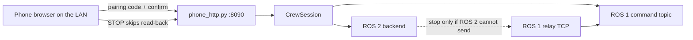

# M3 — phone and web control

The phone page at port 8090 is the primary way to drive the simulator. It uses
the same intent parser, sequencer, and ack gating as the typed CLI. ROS 1 is
the default backend. `HCI_WEB_BACKEND=ros2` uses the M2 Jazzy backend, and a
failed stop on that path is published again through the ROS 1 relay.

This is a personal sim page, not a flight interface. Do not publish port 8090
on the public internet. There is no tunnel and no hosted URL.

## Architecture



`./hci/up.sh` starts the page next to the sim, on the sim container's network
namespace. Docker publishes `8090` on the host. A phone on the same Wi-Fi
opens `http://<computer-lan-ip>:8090`.

The pairing code is printed by the `phone` container and written to
`hci/logs/phone_pairing.txt`.

## How a phone connects

1. `./hci/up.sh`
2. `docker compose -f hci/docker/compose.yml logs phone` and read the code.
3. On the phone, open `http://<lan-ip>:8090`, enter the code, tap Connect.
4. The first phone to connect is the controller. Later phones with the same
   code can watch pose, status, and the camera, and they can hit STOP. They
   cannot start a move.
5. Tap a place. The page shows `Heard …. About to …`. Nothing is queued until
   Confirm. Cancel drops it.
6. STOP is always on screen. It clears the queue and sends `stopAllMotion`
   without that read-back, including while a move is in flight.

Buttons: undock, rack alpha, rack bravo, rack charlie, mid JEM, photograph
alpha, return to dock. The text box uses the same parser.

## Security model

- The server binds `0.0.0.0` inside the sim network so the host can publish it
  on the LAN. That is not a public service. Do not port-forward 8090.
- Every command, status poll, and camera fetch needs the pairing code
  (`X-Pairing-Code` or the `hci_code` cookie). A wrong code is HTTP 401.
- The code is six digits from `secrets`, printed once at startup. It is a
  shared LAN secret, not an account system.
- One controller at a time. A second phone is view-only until the controller's
  heartbeat stops.
- The controller's status poll is the heartbeat (every 0.5 s). If it stops for
  `HCI_HEARTBEAT_S` seconds (default 2) while the robot is moving, the server
  sends `stopAllMotion` and drops the controller. That is the dead-man switch.
  A quiet controller while the robot is idle just loses the lock; it does not
  stop a docked robot.
- STOP from any paired client is allowed. Starting motion is not.

## Voice

Push-to-talk is optional. The page records PCM in the browser, wraps a WAV,
and posts it to `/api/voice`. The server runs the existing Vosk closed grammar
(whole phrase, confidence at least 0.6, stop words still fail-safe). A hit
opens the same Confirm sheet. It does not fly on its own.

Phone browsers only expose the microphone in a secure context (`https://` or
`localhost`). Buttons, confirm, status, camera, and STOP work on plain HTTP.
The Hold to talk button stays disabled when `window.isSecureContext` is false.

On the computer that runs the stack, `http://127.0.0.1:8090` is a secure
context, so the mic can be used there once Vosk is installed.

A phone on the LAN is not localhost. To use its mic, make a certificate
yourself and trust it on that phone. Do not use a tunnel or a public host.
From the computer, for your LAN IP only:

```bash
openssl req -x509 -newkey rsa:2048 -keyout hci/logs/phone.key -out hci/logs/phone.crt \
  -days 30 -nodes -subj "/CN=astrobee-phone" -addext "subjectAltName=IP:192.168.1.20"
```

Replace the IP with the computer's LAN address. Terminate TLS with any local
proxy you already trust (`stunnel`, Caddy on localhost, or similar) bound to
that interface, pointing at `127.0.0.1:8090`. Install `phone.crt` on the phone.
This repository does not start that proxy and does not obtain a public
certificate.

Install the recognizer with `hci/crew_assist/scripts/download_vosk_model.sh`
and `pip install vosk` inside the phone container. Without the model,
`/api/voice` returns 503 and the rest of the page still works.

## ROS 2 stop fallback

If `HCI_WEB_BACKEND=ros2` and the Jazzy side reports that the stop was not
sent (relay down, timeout, or an exception), the phone server opens the M2
ROS 1 relay TCP port and publishes the same `stopAllMotion` there
(`cmd_origin` still empty). The default `./hci/up.sh` path is ROS 1, so stop
is a direct `rospy` publish and the fallback is not on that path.

## Measured on 20 Nov 2026

Playwright at a 390×844 viewport, against the live ISS sim, three mid-flight
stops. The last one:

- tap to `stopAllMotion` publish: **2.1 ms**
- server entry to publish: **0.5 ms**
- executive ack: OK
- the in-flight `simpleMove6DOF` was `CANCELED` ("canceled due to a stop command")

Dead-man on the mock robot with `HCI_HEARTBEAT_S=0.35`: stop fired at a
**0.351 s** gap. The stack default is 2 s, so a dropped phone stops a moving
robot about 2 seconds after the last status poll.

The ROS 1 relay fallback, with the robot already stopped in the cabin, delivered
`stopAllMotion` and the executive acked OK (completed status 1).

## Known limits

- One shared code. Anyone on the LAN who can read the terminal can drive.
- The camera is the latest nav frame re-encoded as PNG, refreshed by polling,
  not a video stream.
- Voice audio is sent to your own process. There is no cloud speech API, and
  there is also no voice until the model is installed and the page is a
  secure context.
- Dead-man timing is the heartbeat gap, default 2 seconds, not a hardware
  e-stop.
- The older rosbridge page on port 8088 is still there. The phone page is the
  one with confirm, the lock, and the dead-man switch.

## Lessons

- Putting Confirm in the browser, and enqueueing only after it, keeps the
  sequencer's y/N behavior without a terminal.
- STOP had to skip that path entirely. A confirm step on stop would be the
  wrong default.
- The M2 relay is a second way to publish. Stop needs a way that does not
  depend on it. The ROS 1 relay socket is that way, and it still goes through
  `astrobee_cmd.build_stop`.
